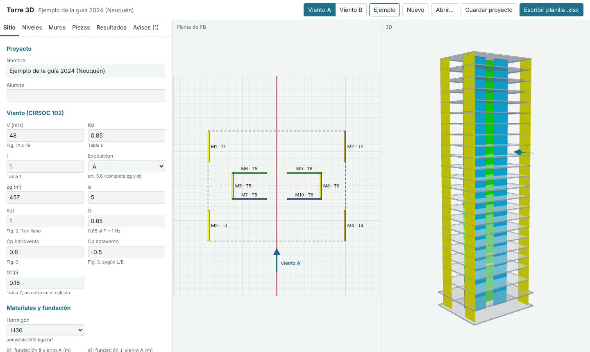

# Torre 3D

Web app that accompanies the course workbook «Edificios en torre» (Electiva Edificios en Torre, FAUD-UNMDP).

The student draws the ground-floor plan (walls, pieces, levels). The app does the following:

- It computes the same results as the workbook, with the same formulas and the same quirks, so the numbers match cell for cell.
- It also computes the corrected values (CIRSOC 102 / the course guide) and shows both side by side with the checks: vuelco, eccentricity, soil, J mínimo, rototraslación, Fig. 9 torsion and flexocompresión.
- It writes the data into the **original course workbook** (`public/planilla_virgen.xlsx`). It only writes data cells, never formulas, and adds a `T3D` sheet that stores the project so the file can be reopened in the app.

The interface is in Spanish.



## How to get it

- **One file, no internet:** [`descargar/torre3d.html`](descargar/torre3d.html) is the whole app, with the course workbook inside (about 0.8 MB). Download it and open it by double-clicking. It works in Chrome, Edge or Firefox, with no server and no internet connection, so it can be shared through the campus site or by email.
- **Web page:** the workflow `.github/workflows/pages.yml` publishes the app on GitHub Pages on every push to `main`. To turn it on, go to Settings → Pages → Source «GitHub Actions». This needs a public repo or a paid plan. `npm run build` also produces a `dist/` folder that can be uploaded to any static host (Netlify, Cloudflare Pages, a faculty server).

## Usage (for students)

1. **Ejemplo** loads the guide's example (Neuquén, 20 floors). **Nuevo** starts an empty project.
2. **Sitio**: wind data, concrete and foundation. The concrete grade gives the admissible stress (H30 → 30 MPa = 300 kg/cm²).
3. **Niveles**: floor levels and plan dimensions B and L. There is a generator for repeated floors.
4. **Muros**: walls go on the plan. Drag them with the mouse or move them with the arrow keys. Each wall belongs to one piece per direction (A and B). Where it is attached decides whether it acts as an alma or an ala.
5. **Piezas**: the equivalent profile of each piece, as written to the J sheets.
6. **Resultados**: «Planilla» shows the workbook's values and «Guía/CIRSOC» shows the corrected ones, with each check.
7. **Funicular**: the graphic check from the guide (2.2). W and G are added in a force polygon, and the resultant has to cut the foundation base inside the middle third. It also draws the line of pressures floor by floor against the central core of each floor plan.
8. **Escribir planilla .xlsx** downloads the filled workbook. Excel or LibreOffice recalculate it on opening. **Guardar proyecto** downloads a `.json`. **Abrir…** accepts either the `.json` or a workbook written by the app.

The project is also saved in the browser (localStorage). ↶/↷ or Ctrl+Z / Ctrl+Y undo and redo. The **Ayuda** tab has these same steps inside the app.

## Development

```bash
npm install
npm run dev        # local server
npm test           # tests: the engine vs. the workbook results (fixture extracted from the Excel) and 300 random projects
npm run build      # typecheck + static build in dist/
npm run build:unico   # single HTML file in dist-unico/index.html (copy it to descargar/torre3d.html)
```

Code layout:

- `src/engine/`: calculation with no DOM.
  - `planilla.ts` replicates the workbook.
  - `mapping.ts` goes from walls to J-sheet rows.
  - `correcciones.ts` holds the corrected values.
  - `verificaciones.ts` holds the checks.
- `src/xlsx/`: xlsx reading and writing with JSZip. It edits the XML directly so it keeps styles and charts, deletes cached results and forces recalculation.
- `src/ui/`: SVG plan, three.js 3D view and panels.
- `tools/`: scripts that extract the fixture from the Excel and write the example for checking with LibreOffice.

### Deploy

The build uses relative paths (`base: './'`), so `dist/` works from any folder. Downloads do not work when the page is embedded in a sandboxed iframe.

Work list: [PENDIENTES.md](PENDIENTES.md).

## Known limitations

These are open questions for the cátedra:

- The virgin «J Tabiques paralelos» sheet is missing the top-ala and left-alma formulas in the rows for pieces 8 and 9. The app uses the other asymmetric rows first.
- In «Flex comp PB paralelos», cells D13:D20 are fixed at 0.01, so pieces 10–17 do not add their own weight.
- It is not settled whether flexible buildings (F < 1 Hz) should use Gf (CIRSOC 102 art. 5.8.2). The app flags them with «atención».
