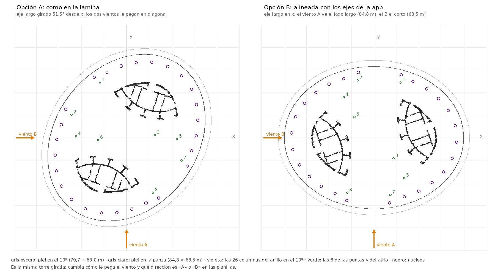

# Leeza SOHO (Zaha Hadid Architects, Pekín, 2019): relevamiento

Base para armar el ejemplo de la Leeza SOHO en la app, con el mismo procedimiento que el núcleo del Gherkin
(`docs/gherkin-nucleo/`). **Etapa 1: todavía no se tocó la app.** Primero se junta, se mide y se revisa con el usuario.

## Fuentes

- **Láminas de ZHA** (publicadas con el proyecto, pasadas por el usuario el 28/11): cortes A-A y B-B con la tabla de
  niveles y escala gráfica; planta de sitio y de PB con escala; plantas de detalle de PB, del 2º (+4,10) y del 10º
  (+37,70); diagramas de masa, losas, columnas, estructura y fachada explotada. **No se suben al repositorio** (son de
  ZHA): acá quedan solo las medidas y los dibujos propios hechos con ellas.
- **Públicas:** [Wikipedia](https://en.wikipedia.org/wiki/Leeza_SOHO), [Bollinger + Grohmann](https://www.bollinger-grohmann.com/en.projects.leeza-soho.html)
  (ingeniería estructural, con la Academia China de Investigación de la Construcción), [Architectural Record](https://www.architecturalrecord.com/articles/14408-leeza-soho-tower-by-zaha-hadid-architects),
  [Dezeen](https://www.dezeen.com/2019/11/20/leeza-soho-zaha-hadid-architects-skyscraper-beijing/),
  [constructsteel](https://constructsteel.org/steel-projects/case-study-leeza-soho/), [World Construction Network](https://www.worldconstructionnetwork.com/projects/leeza-soho-mixed-use-tower-beijing/),
  y en chino: [土木在线 (sismo)](https://bbs.co188.com/thread-9281976-1-1.html), [建筑技艺 (consultor estructural)](http://www.atd.com.cn/Print.aspx?id=7016),
  [双圆监理 (supervisión de obra)](http://www.syjl.com/news/312?cid=9), [知乎](https://zhuanlan.zhihu.com/p/94161469).
  Ninguna fuente pública da medidas de la planta, diámetros de columnas ni espesores: salen de las láminas.

## Lo que dicen las fuentes

- **Altura:** piel hasta +199,97 / +199,99 m, techo del 46º (sala de máquinas) +190,50 m, helipuerto +207,00 m. Altura
  estructural 191,5 m (fuente china). 45 pisos sobre PB y 4 subsuelos (B4 a −19,30 m).
- **Partido:** un cilindro elíptico partido al medio por un atrio de unos 194 m (el más alto del mundo). El corte sigue
  el túnel de servicio del subte que cruza el terreno, y el atrio **gira unos 45°** de abajo arriba para alinear los pisos
  altos con la calle Lize.
- **Estructura:** dos medias torres antisimétricas; cada una es un **núcleo de hormigón armado** («dos ojos» o
  «dos carozos») más un **pórtico curvo de un solo lado** con **columnas de tubo de acero relleno de hormigón,
  inclinadas** (siguen la panza de la torre). Una sola media torre no es estable (vuelco y torsión por el voladizo):
  trabajan juntas gracias a **4 anillos-cinturón de acero** (腰桁架) y puentes de 9 a 38 m de luz sobre el atrio, en los
  pisos de refugio e instalaciones **13, 24, 35 y 45**. Losas compuestas (chapa colaborante y hormigón). La torre supera
  los 150 m que el código chino admite para pórtico de tubos rellenos + núcleo: se aprobó como «superalta» con revisión
  especial. Acero estructural: 18 000 a 24 000 t según la fuente.
- **Columnas:** según la supervisión de obra, el pórtico exterior tiene **34 columnas de B2 al 14º**; hay además
  «columnas del atrio» con curvatura 3D (diagrama de columnas de ZHA).

## Cómo se midió

1. **Cortes:** cada triángulo de nivel de la tabla se detectó y se ajustó con su cota: 5,92 px/m, los 52 niveles con
   menos de 0,4 px de error (≈ 7 cm). En cada piso se midió el ancho exterior de la piel a 1,5 m sobre la losa.
2. **Plantas:** la de sitio tiene escala (6,889 px/m). La de detalle de PB se registró sobre ella por coincidencia de
   dibujo (49 puntos, giro 0,08°): 9,36 px/m. Las del 2º y del 10º se registraron sobre la de PB **usando solo los muros
   negros de los núcleos**: calzan enteros, así que los núcleos son iguales y verticales al menos hasta el 10º.
3. **Columnas:** círculos grises llenos, detectados y llevados al mismo marco (metros, origen en el eje de la torre); a
   cada anillo se le ajustó una elipse descartando lo que no cae en ella.

## Lo medido (etapa 1)

**Perfil (la «panza»):** ancho exterior de la piel. El largo/corto se mantiene en 1,24–1,30.

| z (m) | eje largo (B-B) | eje corto (A-A) |
|---|---|---|
| 17,2 | 75,3 | 58,1 |
| 41,8 | 80,4 | 63,9 |
| 67,4 | 83,6 | 67,1 |
| 92,0 a 105,9 | **84,8** (el más ancho) | **68,5** |
| 130,5 | 83,1 | 66,9 |
| 156,1 | 79,7 | 63,6 |
| 180,7 | 74,0 | 58,7 |
| 195,0 | 70,1 | 54,8 |

Debajo del 4º la piel se mete hacia adentro (la base angosta: la exigencia del acceso de bomberos, según ZHA); los
cortes ahí se mezclan con el basamento y no se midieron.

**Anillo de columnas:**

| Planta | columnas en el anillo | elipse (ejes) | diámetro dibujado |
|---|---|---|---|
| PB (+0,00) | 32 | 48,9 × 61,2 m | 1,48 m |
| 2º (+4,10) | 26 | 48,2 × 64,5 m | 1,43 m |
| 10º (+37,70) | 26 (+ 8 fuera del anillo = **34**) | 57,5 × 72,7 m | 1,25 m |

- De PB al 2º el anillo casi no cambia; del 2º al 10º se abre unos 9 m en cada eje: **las columnas se inclinan hacia
  afuera** siguiendo la panza (unos 3 m adentro de la piel en el 10º).
- En el 10º hay 34 columnas, como dice la supervisión de obra (26 en la elipse y 8 en las puntas del atrio).
- Orientación del eje largo en la lámina: unos 38,5° (igual en el 2º y el 10º). El eje largo de la planta es el del
  corte B-B.
- PB tiene detecciones de más (círculos que no son columnas): el anillo de PB es el menos seguro.

**Núcleos:** dos «ojos» iguales de **29,5 × 15,75 m**, con muros de **~0,55 m** (medido en el 10º), con **simetría
central**: centros en ±(9,66; 17,09) m, a 19,6 m del eje. Iguales en PB, 2º y 10º.

Datos: `relevamiento.json` (niveles, perfil piso por piso, cada columna de cada anillo, centros de los núcleos).

## Decidido con el usuario (28/11)

- **Altura del ejemplo:** 191 m (la estructural; la piel sigue hasta 199,99 m y el helipuerto a 207 m, sin cálculo).
- **Núcleos:** muros de 0,55 m de PB al techo, verticales.
- **Cinturones:** en los pisos dobles de refugio e instalaciones 13–14, 24–25, 35–36 y 45–46.
- **Láminas:** no se suben al repositorio.
- **Atrio:** por ahora no hay plantas de más arriba; se mide cuando aparezcan.

## Orientación: las dos opciones

- **Opción A, como en la lámina:** el eje largo queda girado 51,5° respecto de x (medido en PB, 2º y 10º, con ±1°). Los
  dos vientos de la app le pegan en diagonal, como al edificio real si el viento viene de los ejes de la lámina.
- **Opción B, alineada con la app:** el eje largo sobre x. El viento A ve el lado largo (84,8 m en la panza) y el B el
  corto (68,5 m): son los dos casos extremos y se leen directo en las planillas (B = 84,8, L = 68,5).
- Es la misma torre girada; para decidir conviene verlas las dos armadas. Con la opción A el ancho que ve cada viento
  sale de la proyección de la elipse: en la panza, 75,2 m para el viento A (el ancho en x) y 78,9 m para el B (en y), casi lo mismo para los dos.

## Columnas del pórtico: tamaño recomendado

El diámetro dibujado (1,48 m en PB, 1,25 m en el 10º) incluye el revestimiento contra fuego y la terminación; el tubo de
acero es más chico. Estimación por gravedad (cada columna lleva su parte de los 45 pisos):

- Área de losas ≈ 156 000 m² (elipse de cada piso menos 15 % de atrio y huecos), D = 0,60 t/m² (losa compuesta,
  contrapiso, cielorraso, instalaciones, vigas y fachada), L = 0,25 t/m² (oficinas, CIRSOC 101), la mitad al pórtico y
  34 columnas: **≈ 1 950 t de servicio y ≈ 2 570 t mayoradas (1,2 D + 1,6 L) por columna en la base**.
- Capacidad de un tubo relleno (CIRSOC 301 cap. I: Pno = Fy·As + 0,95·f'c·Ac, φ = 0,75; acero de 345 MPa y hormigón de
  50 MPa, 4,1 m entre losas): Ø 800 × 25 da 1,2 veces esa carga, **Ø 900 × 30 da 1,6**, Ø 1000 × 30 da 1,9 y
  Ø 1200 × 35 da 2,7.
- **Recomendado:** Ø 900 × 30 mm de B2 al 13º (deja margen para el viento, el sismo y la inclinación), Ø 800 × 25 del 14º
  al 24º, Ø 700 × 20 del 25º al 35º y Ø 600 × 20 arriba (la carga baja con los pisos que quedan encima). Coincide con lo
  dibujado si el revestimiento es de unos 25 cm por lado.

## Las 8 columnas fuera del anillo (en el 10º)

En la figura de arriba van en verde y numeradas (en la opción A, igual que en la lámina):

- **1, 2, 7 y 8:** poligonales (no redondas), en la punta del anillo, justo donde la piel se dobla hacia el atrio.
- **3 y 6:** en el borde del atrio, en la curva de la «S», cerca del centro.
- **4 y 5:** redondas y sueltas dentro del piso, entre el anillo y el atrio.

Propuesta: 1, 2, 3, 6, 7 y 8 son las **columnas del atrio** del diagrama de ZHA (curvatura 3D, siguen el giro del
atrio); 4 y 5 son columnas secundarias del piso. Falta que el usuario lo confirme.

## Para revisar con el usuario

1. Elegir entre la opción A y la B (o dejar las dos) cuando se armen.
2. Confirmar la lectura de las 8 columnas fuera del anillo.
3. Si aparecen plantas de más arriba, medir el giro del atrio piso por piso.
